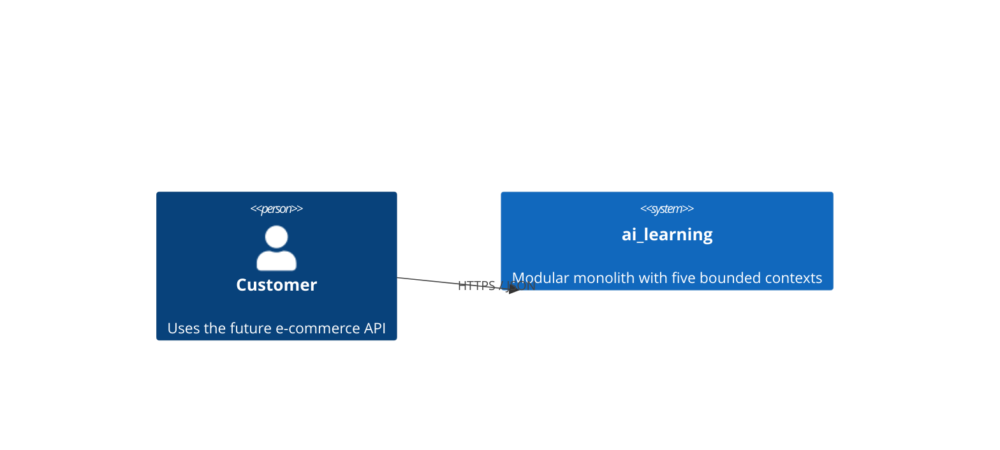
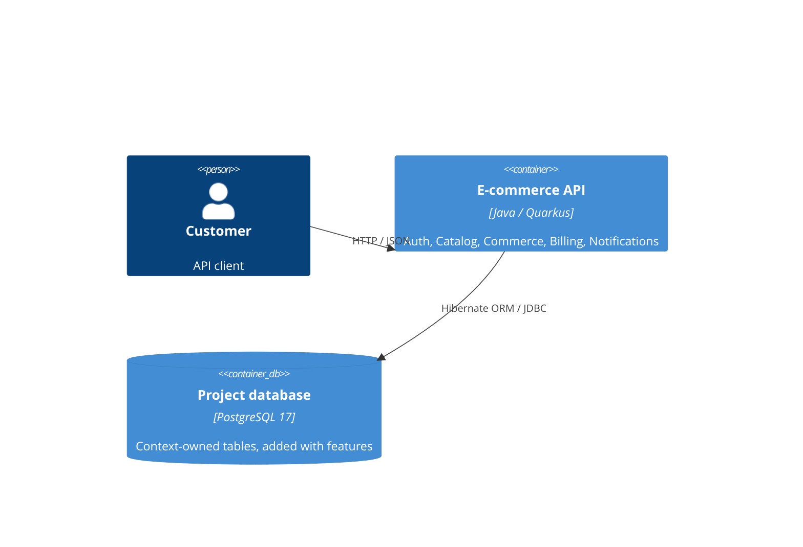

# Architecture map — ai_learning

Фундамент нового навчального проєкту. reflects_commit позначає коміт погодженого фундаменту, після якого матеріалізовано каркас за [планом](features/_scaffold/tasks/tasks.json); результати — у [трекері](features/_scaffold/tasks/tracker.md) та [матеріалах здачі](lesson-submission.md). Контексти та події — з [bc-map.md](bc-map.md); усі BC використовують Hexagonal за рішенням власника.

## Stack

- Java 21 language level; Quarkus 3.40.1, Maven Wrapper 3.9.16.
- Quarkus REST + Jackson; Hibernate ORM (без Panache), JDBC PostgreSQL, Flyway.
- PostgreSQL 17 у контейнері лише цього проєкту; бізнес-таблиць на старті немає.
- JUnit/Quarkus test + REST Assured: запуск застосунку та HTTP smoke-тест без БД.
- ArchUnit 1.5.1: межі контекстів, чистий domain та напрямок app/infra.
- Команди: ./mvnw verify, ./mvnw test, ./mvnw -Dtest=ArchitectureTest test, ./mvnw quarkus:dev. Windows: .\mvnw.cmd.
- GitHub Actions виконує verify на JDK 21. Без глобальних встановлень; Maven repo і wrapper cache у .cache/ цього проєкту.

## C4 — target system context

## C4 — target containers

## Module inventory

Base package: com.ivantsvelikov.ailearning. Paths below are relative to src/main/java/com/ivantsvelikov/ailearning/.

| Module | Path | Target layers | Wiring | Responsibility |
| --- | --- | --- | --- | --- |
| Auth | modules/auth/ | domain/app/infra | CDI in infra when implemented | User, registration, login |
| Catalog | modules/catalog/ | domain/app/infra | CDI in infra when implemented | Product, Category; initially read-only |
| Commerce | modules/commerce/ | domain/app/infra | CDI in infra when implemented | Order |
| Billing | modules/billing/ | domain/app/infra | CDI in infra when implemented | Subscription; not a payment gateway |
| Notifications | modules/notifications/ | domain/app/infra | CDI in infra when implemented | Notification, Sender |
| Bootstrap | bootstrap/ | infrastructure | Quarkus discovery | Technical /health endpoint only |

Каркас створює по одному README у кожному BC, без порожніх Java-класів і бізнес-логіки. Hibernate не потребує фіктивної entity для старту.

## Conventions

- domain: лише JDK і доменні типи свого BC; без CDI, JPA, HTTP, Quarkus.
- app: сценарії та порти; залежить від domain, без infra, CDI/JPA/HTTP. Wiring виконується зовні.
- infra: REST, CDI wiring, JPA entities, repositories and mappers; залежить від app/domain.
- JPA-сутності окремі від доменних об'єктів. Hibernate schema-management=validate, sql-load-script=no-file. Flyway володіє DDL, schema update/drop-and-create заборонені.
- Між BC заборонені прямі імпорти. Контракти подій під shared/events; реалізація доставки — майбутня фіча. In-memory bus не гарантує durable delivery.
- Події: Auth/UserRegistered -> Notifications; Commerce/OrderPlaced -> Billing і Notifications; Billing/SubscriptionCreated -> Notifications. Catalog без подій.
- Майбутні ID: UUID, створені застосунком. Гроші: цілі minor units, без floating point.
- Майбутні помилки REST: JSON {code,message}; бізнес-помилки й адаптери ще не реалізовані.
- Migration V0.0.0__bootstrap.sql — порожній старт без бізнес-об'єктів. Далі перша цифра змінюється для створення/видалення таблиць, друга — допоміжних DB-об'єктів, третя — ALTER за правилами AGENTS.md.
- test profile відключає JDBC, ORM і Flyway; не запускає Dev Services. Профіль dbtest явно вмикає перевірку міграцій на дозволеній навчальній БД.
- ArchUnit перевіряє production classes; на початку BC порожні. Окремі негативні fixtures доводять, що правила ловлять порушення.

## Datastores

| Store | Engine | Access | Scope |
| --- | --- | --- | --- |
| ai_learning | PostgreSQL 17 | Hibernate ORM + Flyway | Isolated Docker Compose project ai-learning; no existing DB access |

Flyway Community не має автоматичного undo для SQL-міграцій. Bootstrap не змінює бізнес-схему; перевіряємо migrate, validate та повторний migrate без змін. Для наступних змін rollback проєктується окремо. Жодного clean-at-start.

## Frontend / UI foundation

N/A: HTTP API only. Frontend, design system and screens are out of this lesson.

## Where things live

- Нова фіча: modules/<bc>/domain, app, infra; інструкція — README конкретного BC.
- Технічний старт: bootstrap/HealthResource.java; конфігурація — src/main/resources/application.properties.
- SQL: src/main/resources/db/migration/; тести: src/test/java/.
- Повні команди: docs/development.md; фактичні перевірки й кроки здачі: docs/lesson-submission.md.

## Constraints and unknowns

- Немає бізнес-ендпоінтів, сутностей, реальних повідомлень, платіжної інтеграції або production-auth.
- UNKNOWN: payload contracts, delivery guarantees, production deployment. Вирішуються у фічах.
- Docker daemon був недоступний при первинній перевірці. Фактичний DB-run залежить від запуску Docker і дозволу власника.
- /clear, /context і скрін Memory files перевіряються у справжній новій сесії Claude Code; Codex не може засвідчити їх за власним контекстом.

## Reconciliation

docs/ARCHITECTURE.md — незмінене демо курсу, не authored architecture цього застосунку. Кореневий ARCHITECTURE.md — коротка вижимка цієї карти. AGENTS.md зберігає всі попередні правила й доповнений конвенціями каркаса.
