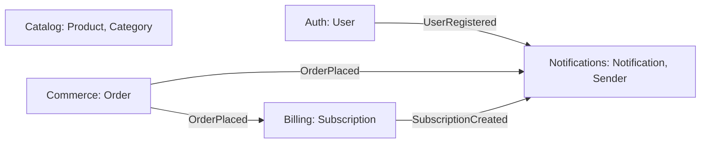

# Карта bounded contexts

Навчальний e-commerce проєкт. Контексти та події взято з [ARCHITECTURE.md демо курсу](https://github.com/genkovich/agentic-engineering-course-public/blob/main/modules/4-prompting-mastery/4.8-bc/go/stage-3-hexagonal/ARCHITECTURE.md). Локальна копія джерела — [ARCHITECTURE.md](ARCHITECTURE.md); це довідковий файл демо, а не архітектура майбутнього застосунку. Автор джерела: Kyrylo Hen (genkovich), 2026; [ліцензія MIT](demo-LICENSE.txt).

## Контексти й відповідальність

| Контекст | Власні сутності | Відповідальність і межі |
| --- | --- | --- |
| Auth | User | Реєстрація, логін і паролі. Не оформлює замовлення та не надсилає повідомлення. |
| Catalog | Product, Category | Каталог товарів і категорій. У межах демо лише читання; не керує замовленнями. |
| Commerce | Order | Оформлення замовлення та його склад. Кошик спрощений, окремої сутності Cart немає. |
| Billing | Subscription | Підписки на плани basic / pro / enterprise. Не володіє замовленням; реагує на OrderPlaced. |
| Notifications | Notification | Доставка email / push через порт Sender. Не вирішує бізнес-правила інших контекстів. |

README описує загальну ідею магазину. Адміністрування, залишки товарів, доставка та реальна оплата — майбутні можливості, які тут не додають нових контекстів чи подій. Підписки Billing збережено саме для відповідності демо.

## Події

| Подія | Публікує | Слухає | Значення |
| --- | --- | --- | --- |
| UserRegistered | Auth | Notifications | Користувача зареєстровано; можна надіслати привітання. |
| OrderPlaced | Commerce | Billing, Notifications | Замовлення оформлено; Billing обробляє подію, Notifications сповіщає користувача. |
| SubscriptionCreated | Billing | Notifications | Підписку створено; можна надіслати підтвердження. |

Catalog не публікує і не слухає подій у цьому демо. Notifications лише слухає; NotificationSent не додаємо. Формати payload і гарантії доставки будуть визначені під час проєктування контрактів.

## BC Map

Стрілки означають асинхронні події через спільну шину; видавець не знає підписників. Ізольований Catalog на графі відповідає джерелу.

## Словник

| Термін | Контекст | Значення |
| --- | --- | --- |
| User | Auth | Обліковий запис користувача; інші BC зберігають лише його ідентифікатор. |
| Product | Catalog | Товар із назвою, ціною та посиланням на категорію. |
| Category | Catalog | Категорія для групування товарів. |
| Order | Commerce | Оформлене замовлення з позиціями, сумою та статусом. |
| Order item | Commerce | Позиція замовлення; не сама сутність Product з Catalog. |
| Subscription | Billing | Підписка користувача на тарифний план; не замовлення товарів. |
| Plan | Billing | Тариф basic, pro або enterprise. |
| Notification | Notifications | Повідомлення користувачеві з каналом і вмістом. |
| Sender | Notifications | Порт доставки повідомлень, який реалізують адаптери email / push. |

## Будова кожного контексту

За явним рішенням власника проєкту всі п'ять BC використовують Hexagonal Architecture і будову domain/app/infra. Єдина структура полегшує навчання та перевірку залежностей. Для простих Auth/Catalog це більше розділення, ніж потрібно початковим сценаріям; приймаємо цей компроміс свідомо. Це власний вибір, а не твердження про числові пороги лекції.

| Контекст | Обрана будова | Обґрунтування |
| --- | --- | --- |
| Auth | domain/app/infra | Єдина будова BC; HTTP, хешування паролів та Hibernate залишаються адаптерами поза ядром. |
| Catalog | domain/app/infra | Єдина будова BC; доменна модель товарів відокремлена від JPA та HTTP. |
| Commerce | domain/app/infra | Правила складу, суми та статусу замовлення варто відокремити від збереження, HTTP і публікації подій. |
| Billing | domain/app/infra | Правила плану і строку підписки відокремлюємо від збереження та входів HTTP / OrderPlaced. |
| Notifications | domain/app/infra | Є кілька входів подій і адаптери email / push; порт Sender ізолює доставку від сценаріїв. |

Стиль залежностей — Hexagonal для кожного BC. Java + Quarkus, Hibernate ORM, PostgreSQL та Flyway; корінь модулів — src/main/java/com/ivantsvelikov/ailearning/modules/. На етапі каркаса в кожному BC лише README.md; підтеки domain/app/infra з'являться з першими фічами.

## Правила меж

- Кожен BC володіє своїми сутностями та сховищем. Прямих імпортів внутрішніх модулів іншого BC немає.
- Міжконтекстні події використовують спільні контракти без імпорту чужих доменних сутностей.
- У domain/app/infra домен не залежить від HTTP, БД або адаптерів; app координує сценарії, infra реалізує зовнішні інтеграції.
- У shared допускаються лише технічні засоби та контракти подій; бізнес-логіка залишається у своєму BC.
- Автоматична перевірка імпортів — ArchUnit у src/test/java/com/ivantsvelikov/ailearning/architecture/ArchitectureTest.java. Запуск: Maven -Dtest=ArchitectureTest test; входить також у Maven verify. На порожніх BC правила перевірені негативними fixtures.
